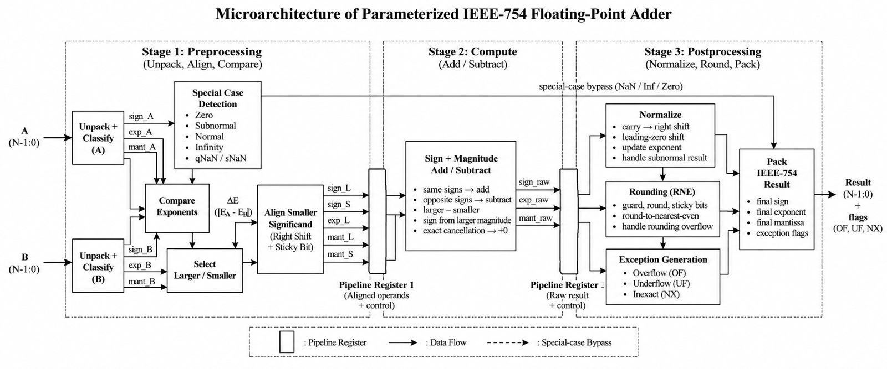

# Assignment 1: Parameterised IEEE-754 Floating-Point Adder

A floating-point adder in Bluespec SystemVerilog, parameterised by exponent width *e* (2–15) and fraction width *m* (2–63), so the same RTL implements FP8, binary16, bfloat16, binary32, binary64 and non-standard formats.



## Microarchitecture

The datapath has three main stages with FIFO/register boundaries between them, which decouple the stages while preserving result order:

1. **Pre-align** (`preAlign` rule): classify operands (zero, subnormal, normal, infinity, quiet and signalling NaN), resolve special cases, compare magnitudes and right-shift the smaller significand while keeping guard, round and sticky bits.
2. **Add / subtract** (`addSubtract` rule): add significands for equal signs, otherwise subtract magnitudes; exact cancellation gives +0.
3. **Normalise and round** (`normalizeStep`, `roundPack` rules): a variable left shift (not a one-bit-per-cycle loop) restores the leading bit after cancellation; round-to-nearest, ties-to-even with roundUp = G ∧ (S ∨ L); handle rounding overflow, pack the result and raise overflow, underflow and inexact flags.

Corner cases handled include subnormal operands and results (no premature flush to zero), sticky-bit generation for large exponent differences, ties-to-even halfway cases, signalling NaNs raising *invalid*, and +∞ + −∞ producing NaN with *invalid*.

## Verification

[`gen_vectors.py`](tb/gen_vectors.py) is an **exact IEEE-754 addition oracle** written with Python big integers (never Python floats), so it is exact for every (*e*, *m*), including non-standard widths. It can also cross-check against numpy for the IEEE formats and against Berkeley TestFloat. [`run_all.sh`](tb/run_all.sh) generates vectors and runs the Bluesim [testbench](tb/Testbench.bsv) for every configuration:

| Configuration | e | m | Vectors | Result |
|---|---|---|---|---|
| OCP FP8 E4M3 | 4 | 3 | 20000 | PASS |
| Binary16 | 5 | 10 | 20000 | PASS |
| Bfloat16 | 8 | 7 | 20000 | PASS |
| Binary32 | 8 | 23 | 20000 | PASS |
| Binary64 | 11 | 52 | 20000 | PASS |
| Extra narrow | 2 | 2 | 20000 | PASS |
| Extra wide | 15 | 63 | 20000 | PASS |

## Synthesis (binary32, SAED 14 nm, SS 0.72 V 125 °C)

| Metric | Result |
|---|---|
| Clock period | 0.71 ns (≈ 1.408 GHz) |
| Worst register-to-register path | 0.69 ns (29 levels of logic) |
| Worst setup slack / total negative slack | 0.00 ns / 0.00 ns |
| Leaf cells | 3369 (2900 combinational, 469 sequential) |
| Cell area | 2235.10 µm² |
| Design area including nets | 4007.97 µm² |

At 0.70 ns four paths showed a reported slack of −0.00 (a rounding artefact), so the period was set to 0.71 ns. Reports are in [`synthesis/reports/`](synthesis/reports/).

## Running

```bash
cd tb
./run_all.sh          # 20000 vectors per configuration
./run_all.sh 5000     # fewer vectors
```

Requires `bsc` and `python3`.

## Files

```
rtl/FloatingPointAdder.bsv   Parameterised adder
tb/                          Testbench, vector generator, run script
synthesis/reports/           Design Compiler QoR and timing reports
report/                      Submitted report
```
